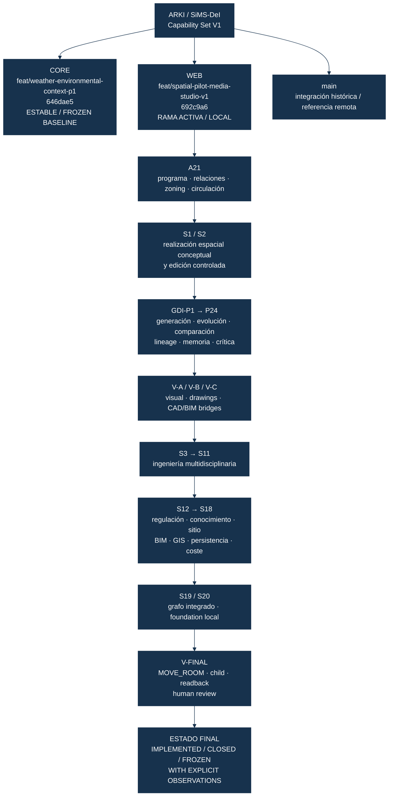

# ARKI / SiMS-DeI — Organigrama técnico y estado del proyecto

**Corte de estado:** 18 de septiembre de 2026. **Fuente:** repositorios locales auditados. **Presentación:** monocromática; todos los nodos usan el mismo tono azul oscuro para evitar interpretar colores como autoridad, prioridad o calidad.

## 1. Vista ejecutiva



La secuencia debe leerse de arriba hacia abajo. El diagrama muestra **dependencia e integración**, no una escala de calidad ni un ranking.

## 2. Ramas y commits

| Repositorio | Rama | HEAD | Estado | Contenido principal |
|---|---|---:|---|---|
| Core | `feat/weather-environmental-context-p1` | `646dae5` | Estable; baseline técnico congelado | SICL Core, espacial, evidencia, operaciones y contratos base. |
| Web | `feat/spatial-pilot-media-studio-v1` | `692c9a6` | Rama activa local; Capability Set V1 cerrado | A21, S1/S2, GDI, autoría, visual, ingeniería, S12–S20, V-FINAL. |
| Web | `main` | Referencia local/remota | Rama de integración histórica | No es la rama activa de trabajo en esta sesión. |

El Web activo contiene, en orden reciente, los hitos `692c9a6`, `0203e0d`, `fa13280`, `37cb2ea`, `47f12fa`, `fa37433`, `0376f24` y `af88192`. Estos representan el cierre progresivo de Capability Set V1.

## 3. Capacidades por rama

### 3.1 Core — `feat/weather-environmental-context-p1`

Core contiene los contratos y operaciones de bajo nivel que soportan la superficie arquitectónica. La rama se mantiene sin modificaciones en este cierre.

| Dominio | Capacidad existente | Estado |
|---|---|---|
| SICL | Ontología, operaciones y contratos espaciales | Estable |
| Spatial operations | Realización y reemplazo controlado | Implementado |
| Evidence | Evidencia espacial y provenance | Implementado |
| Environmental context | Contexto solar, viento y temperatura en el alcance aprobado | Cerrado con observaciones |
| Multiscale evidence | Evidencia georreferenciada y estados de incertidumbre | Cerrado; datos reales requeridos para uso profesional |
| API/Core runtime | Contratos base y pruebas Core heredadas | Baseline; no modificado por Capability Set V1 |

**SHA Core:** `646dae525dd1db4b9f357aced21cc1302fc791a0`.

### 3.2 Web — `feat/spatial-pilot-media-studio-v1`

Esta es la rama que concentra la capacidad arquitectónica visible y sus pruebas.

| Bloque | Capacidades | Estado |
|---|---|---|
| A21 | Programa arquitectónico, relaciones, zonas, parti, circulación, memoria de diseño y configuración espacial | Implementado; hipótesis trazables |
| S1 | Espacios, límites, muros, particiones, puertas, ventanas, escaleras, shafts, rutas y validaciones | Implementado como planta conceptual; no constructiva |
| S2 | `MOVE_ROOM`, `RESIZE_ROOM`, `OFFSET_ROOM`, `RESHAPE_SPATIAL_ELEMENT`, `EDIT_ROOM` | Implementado; autorización humana y padre inmutable |
| A15–A18 | Lectura, crítica, revisión controlada y diagnóstico de brechas | Implementado con observaciones |
| A29–A34 | Conectividad, aperturas, puertas, evacuación y estados de evaluación | Parcial/derivado; cumplimiento profesional no afirmado |
| GDI-P1–P8 | Inteligencia generativa arquitectónica, perspectivas, síntesis y conocimiento | Cerrado/Frozen baseline |
| GDI-P9–P24 | DNA, ramas, distancia, replay, explicación, counterfactuals, backtracking, mutación y studio loop | Implementado con observaciones |
| K1–K11 | Learning contract, curriculum, provenance, store, need detection, specialist perspectives, synthesis, fuentes reales y almacenamiento lógico | Cerrado/Frozen; no K12 |
| V-A | Viewer espacial 2D/3D, massing, comparación, overlays y visualización | Implementado con observaciones |
| V-B | Planos conceptuales, site plan, sección/elevación derivadas, anotaciones y SVG | Implementado; paquete profesional firmado no afirmado |
| V-C | Identidad BIM, IFC massing y adapters DXF/GLB | Implementado en alcance de intercambio; Revit externo pendiente |
| Macroorder 03 | 48 disciplinas, dependencias, reservas, rutas, conflictos e impactos | Implementado con estados conceptuales/unknown |
| S12 | Cadena regulación → fuente → regla → aplicabilidad → evidencia → evaluación | Implementado; sin compliance claim sin fuente |
| S13 | Federación de conocimiento reutilizando K1–K11 | Implementado; no K12 |
| S14 | Inteligencia de desarrollo de sitio | Implementado como foundation; datos de parcela requeridos |
| S15 | Consolidación del modelo BIM canónico con ingeniería | Implementado; no segundo BIM |
| S16 | GIS/catastro/survey foundation, CRS y GeoJSON semantics | Implementado como adapter; levantamiento real pendiente |
| S17 | Sobre de persistencia local y restauración determinista | Implementado localmente; colaboración productiva pendiente |
| S18 | Cantidades derivadas y estados de coste/ciclo de vida | Implementado; tasas y costes permanecen `UNKNOWN` |
| S19 | Grafo integrado de arquitectura, ingeniería, regulación, coste, dibujos, BIM, GIS y memoria | Implementado como foundation |
| S20 | Configuration, deterministic local state, health/readiness foundations y recovery envelope | Implementado localmente; no deployment |
| V-FINAL | `MOVE_ROOM` autorizado, child, readback, identidad y estados de recomputación | Probado localmente con observaciones explícitas |

**SHA Web:** `692c9a6cc96c30bcb22d38364b4c82a18e3c9633`.

## 4. Estados globales

| Estado | Significado en este proyecto | Capacidades principales |
|---|---|---|
| `PROVEN` | Existe implementación y prueba determinista local | A21, S1/S2, persistencia envelope, controles de autoridad |
| `PROVEN_WITH_OBSERVATIONS` | Funciona dentro del alcance local, con límites declarados | GDI, V-A/V-B, ingeniería, S12–S20, V-FINAL |
| `EXTERNAL_VALIDATION_REQUIRED` | Existe adapter/contrato, pero falta un entorno o dato externo legítimo | Revit round-trip, IFC externo, GIS survey, signed professional outputs |
| `UNKNOWN` | No hay datos o motor suficiente para afirmar el resultado | Compliance, tasas de coste, topografía, capacidades físicas no verificadas |
| `FROZEN` | No se continúa expandiendo sin una nueva orden real | GDI-P25, D33, K12, S21, V25 |

## 5. Qué existe hoy y qué no debe confundirse

**Existe hoy:** un sistema local de inteligencia y síntesis arquitectónica controlada. Puede recibir intención programática, producir configuraciones espaciales hipótesis, construir una planta conceptual verificable, derivar un modelo canónico, generar alternativas, comparar y criticar, ejecutar modificaciones humanas acotadas, propagar impactos y conservar lineage y provenance.

**No existe como afirmación profesional:** una planta permit-ready, documentación constructiva firmada, cálculo estructural aprobado, certificación normativa, levantamiento topográfico real, round-trip nativo con Revit, colaboración multiusuario productiva, costes de mercado verificados o un agente autónomo que tome decisiones por el arquitecto.

## 6. Estado de publicación y trabajo local

```text
CORE CHANGE IN THIS CLOSURE = NO
WEB ACTIVE HEAD = 692c9a6
PUSH = NO
PR = NO
MERGE = NO
DEPLOYMENT = NO
HUMAN AUTHORITY = PRESERVED
```

La auditoría detecta documentos y capturas históricas no rastreados en `docs/`. No forman parte del último commit de Capability Set V1 y deben tratarse como **artefactos históricos pendientes de clasificación**, no como código activo adicional.

## 7. Lectura ejecutiva en una frase

**ARKI está organizado como un Core estable y una rama Web activa que integra inteligencia arquitectónica, generación espacial conceptual, evolución GDI, autoría, ingeniería y memoria profesional en un Capability Set V1 local cerrado; las conexiones reales con Revit, GIS levantado, cálculo profesional, costes verificados y producción permanecen explícitamente pendientes.**

## References

[1]: https://mermaid.js.org/ "Mermaid — Diagramming and charting tool"
