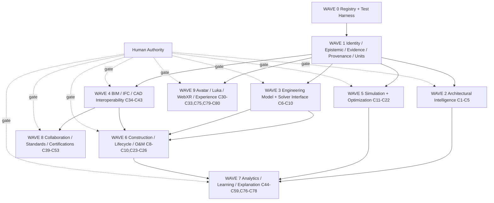

# C1–C80 Executable Dependency DAG — Wave 0

Wave 0 does not claim that this DAG is runtime-executed. It is the dependency plan required before activation. The actual critical path is W0 → W1 → W2/W3/W4, with simulation, lifecycle, learning, collaboration, and experience downstream.
